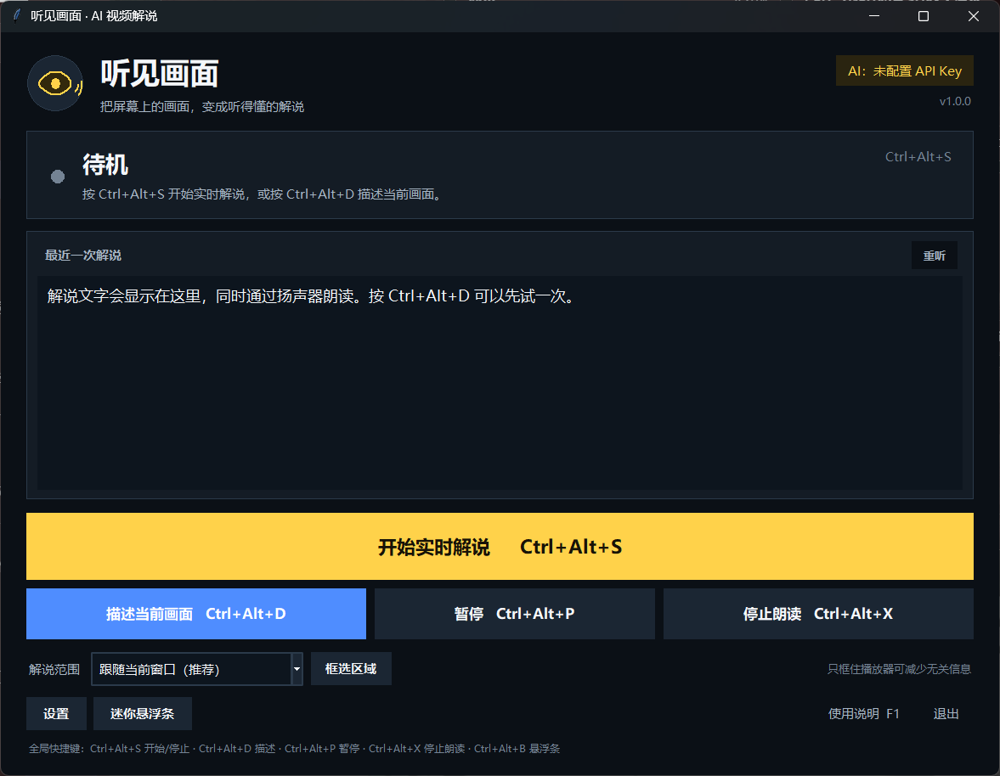

# 听见画面

**把屏幕上的视频和画面，变成视障用户可以听懂的实时解说。**

听见画面是一款 Windows 桌面程序：它定时截取正在播放的视频或当前窗口，调用豆包（火山方舟）等视觉大模型理解画面，再用 Windows 自带的中文语音朗读出来。适合抖音、B 站、腾讯视频、本地播放器等任何在屏幕上播放的内容。

> 它不是 Windows“讲述人”的替代品。讲述人负责朗读按钮、菜单等系统控件；听见画面负责“看懂”视频画面，补充人物、动作、场景、表情和屏幕文字。两者可以同时使用。



> 本项目是个人开发的无障碍工具，与字节跳动、火山方舟、B 站、抖音均无隶属或官方合作关系。

---

## 一、最快开始（3 步）

1. **打开程序**：双击桌面上的 `听见画面` 快捷方式（主程序在 `%LOCALAPPDATA%\Programs\听见画面\听见画面.exe`）。
2. **填写 API Key**：点“设置 → AI 服务”，粘贴火山方舟的 API Key，点“测试连接”，成功后“保存并关闭”。
3. **开始解说**：打开抖音或 B 站播放视频，按 `Ctrl+Alt+S`。程序会收起主窗口，显示迷你悬浮条，并开始朗读画面解说。

想只听当前这一帧，按 `Ctrl+Alt+D`。

> 第一次使用前，需要有一个可用的豆包视觉模型 API Key。程序本身不包含 Key，也不包含任何免费额度。

---

## 二、配置豆包（火山方舟）

1. 打开 [火山方舟控制台](https://console.volcengine.com/ark)，完成注册和实名认证。
2. 在“模型广场”开通一个**支持图片/视觉理解**的豆包模型，例如 `Doubao-Seed-1.6-vision`。
3. 在“API Key 管理”创建一个 API Key，复制完整 Key。
4. 在程序的“设置 → AI 服务”中填写：
   - **API 地址**：`https://ark.cn-beijing.volces.com/api/v3`（默认已填）
   - **模型 ID**：`doubao-seed-1-6-vision-250815`（默认已填；如果控制台显示的是 `ep-` 开头的推理接入点 ID，也可以直接填 `ep-...`）
   - **API Key**：粘贴你的 Key
5. 点“测试连接”。成功后会朗读“连接成功”，再保存。

模型和价格会调整。如果提示 404 或“模型不存在”，请以控制台当前显示的**模型 ID / 推理接入点 ID** 为准，直接替换即可。

### 使用其他 AI

“服务预设”选择“自定义 OpenAI 兼容接口”，填写：

- API 地址：例如 `https://api.openai.com/v1`，或你使用的兼容服务地址
- 模型 ID：例如 `gpt-4o-mini`
- API Key

程序按 OpenAI Chat Completions 的图片消息格式发送请求（`image_url` + base64 JPEG）。不支持图片输入的模型会报错。

---

## 三、快捷键

| 快捷键 | 功能 |
|---|---|
| `Ctrl+Alt+S` | 开始 / 停止实时解说 |
| `Ctrl+Alt+D` | 描述当前画面（可反复按） |
| `Ctrl+Alt+P` | 暂停 / 继续实时观察 |
| `Ctrl+Alt+X` | 立即停止朗读 |
| `Ctrl+Alt+M` | 显示 / 收起迷你悬浮条（被占用时自动改用 `Ctrl+Alt+B`） |
| `F1` | 打开使用说明 |
| `Ctrl+,` | 打开设置 |

所有功能也都有大按钮，不依赖快捷键。全局快捷键在其他软件前台时也有效；如果某个快捷键被占用，程序会自动换一个，并在主窗口底部显示实际使用的键。

---

## 四、解说范围怎么选

主界面“解说范围”有三种：

- **跟随当前窗口（推荐）**：自动跟随最前面的视频窗口，适合浏览器、抖音客户端、播放器。
- **全屏（鼠标所在屏幕）**：把鼠标移到目标显示器上再开始，适合全屏播放。
- **自定义区域**：点“框选区域”，拖动鼠标只框住播放器，能减少无关信息、降低费用，也避免把聊天、密码等敏感内容发出去。

使用“跟随当前窗口”时，如果程序自己在前台，它会自动寻找后面的视频窗口；开始后默认收起主窗口，避免把自己截进去。

---

## 五、设置建议

- **观察间隔**：默认 4.5 秒。实时追剧建议 4～5 秒；想看得更细可以选 6 或 8 秒。
- **解说详细程度**：实时追视频选“简洁”；想理解一张画面选“详细”。
- **画面几乎没变时跳过请求**：默认开启，省费用。画面变化不大时不会重复请求。
- **新解说立即打断上一句**：默认开启，保证解说跟得上最新画面。上一句被截断是正常的。
- **视频没有声音：同时朗读字幕和台词**：仅在视频静音、或你需要读字幕时勾选。默认不勾选，因为用户通常能听到原声，AI 应专注补充画面。
- **快速模式**：默认开启，关闭豆包的深度思考，响应更快。若模型不支持，会自动去掉该参数重试。
- **朗读声音 / 语速 / 音量**：使用 Windows 自带离线语音，不额外收费。中文系统一般有“Microsoft Huihui Desktop”。

---

## 六、隐私和安全

- 截图只在内存中处理，**不会保存到硬盘**。每次请求会把当前一帧发送到你填写的 AI 接口。
- API Key 使用 Windows 当前用户的 **DPAPI** 加密后保存在本机配置文件中；不会写进日志。
- 程序不收集遥测，不上传到第三方服务器（只访问你配置的 AI 地址）。
- 建议用“自定义区域”只框播放器，避免把密码、聊天、身份证等敏感画面发给 AI。
- 配置文件与日志在程序目录的 `data` 文件夹（便携版）：
  - `data\config.json`：配置（Key 已加密）
  - `data\logs\app.log`：诊断日志（不含 Key，不记录解说原文）

---

## 七、常见问题

**401 / 403：Key 无效、过期或模型未开通**
重新创建 API Key，确认已开通对应视觉模型，并检查 Key 是否复制完整。

**404：模型或地址不存在**
填写控制台当前的模型 ID 或 `ep-` 推理接入点 ID；确认 API 地址是 `https://ark.cn-beijing.volces.com/api/v3`。

**429：请求太频繁 / 额度不足**
把观察间隔调到 6～8 秒，或检查账户余额和限流。

**画面是黑的 / 读不出**
部分版权视频禁止截屏，或播放器用了独占全屏。改用窗口播放、关闭硬件加速，或换“全屏（鼠标所在屏幕）/自定义区域”试试。

**没有声音**
在 Windows“设置 → 时间和语言 → 语音”中安装中文语音包；检查系统音量和默认输出设备；在“设置 → 语音”点“试听这段声音”。

**快捷键没反应**
可能被其他软件占用（主窗口底部会提示实际键位）；直接用界面按钮也可以。以管理员身份运行的视频软件可能拦截普通权限程序的全局快捷键。

**程序提示已经在运行**
它只允许开一个实例，避免两个声音重叠。按 `Ctrl+Alt+M` 找悬浮条，或从任务栏打开。

**杀毒软件误报**
单文件/打包的 Python 程序有时会被误报。可把程序目录加入信任；源码在 `HearScreen` 文件夹，可自行审查和构建。

---

## 八、局限

- 不是逐帧直播：受网络和模型速度影响，通常有 3～8 秒延迟；它解说“刚刚看到的一帧”，不是实时逐帧。
- AI 可能看错或编造。程序在提示词里要求“看不清就说看不清”，但不能保证 100% 准确；重要信息请谨慎对待。
- 需要联网和 API 额度；每次请求按图片和文字 token 计费。
- 不读取视频内部音轨，不替代视频原声；它补充的是画面信息。
- 不能用于避障、导航等安全关键场景。

---

## 九、从源码构建

```powershell
# Python 3.10 64 位
pip install -r requirements.txt
powershell -ExecutionPolicy Bypass -File .\build.ps1
```

`build.ps1` 构建**目录版** `dist_package\听见画面\听见画面.exe`（`_internal` 与 exe 放在一起）。目录版启动更快，也不依赖临时目录，在受管控的电脑上更稳定。随后运行 `install.ps1` 可安装到当前用户并创建桌面/开始菜单快捷方式。

如果希望尽量压成一个文件，也可以自行加 `--onefile`：

```powershell
python -m PyInstaller --noconfirm --clean --onefile --windowed `
  --name HearScreen --icon assets\icon.ico `
  --add-data "assets;assets" `
  --hidden-import win32com.client --hidden-import pythoncom --hidden-import pywintypes `
  run.py
```

单文件版每次启动都要解压到临时目录；如果系统策略禁止在临时目录创建/删除文件夹，会报 “Could not create temporary directory”，此时请用目录版。

安装后，主程序位于：

```
%LOCALAPPDATA%\Programs\听见画面\听见画面.exe
```

桌面的 `听见画面` 快捷方式直接指向这个 exe。也可以从开始菜单打开。若快捷方式丢失，直接运行上面的路径即可。安装脚本会保留已有的 `data` 文件夹，升级不会丢配置。

### 目录结构

```
HearScreen/
  run.py                 源码入口
  hear_screen/
    main.py              启动、自检、单实例
    ui.py                主界面、设置、迷你条、框选
    narrator.py          实时调度与变化检测
    capture.py           截屏与图片压缩
    ai.py                豆包 / OpenAI 兼容视觉接口
    speech.py            Windows SAPI 语音
    config.py            配置、DPAPI、便携目录
    winapi.py            DPI、窗口、热键、深色标题栏
  assets/icon.ico
  build_tools/
  README.md
```

自检（不打开界面，结果写入 JSON）：

```powershell
& "$env:LOCALAPPDATA\Programs\听见画面\听见画面.exe" --selftest D:\selftest.json
```

---

## 十、版本

`1.0.0` · 2026-10

愿你听见画面里的世界。
